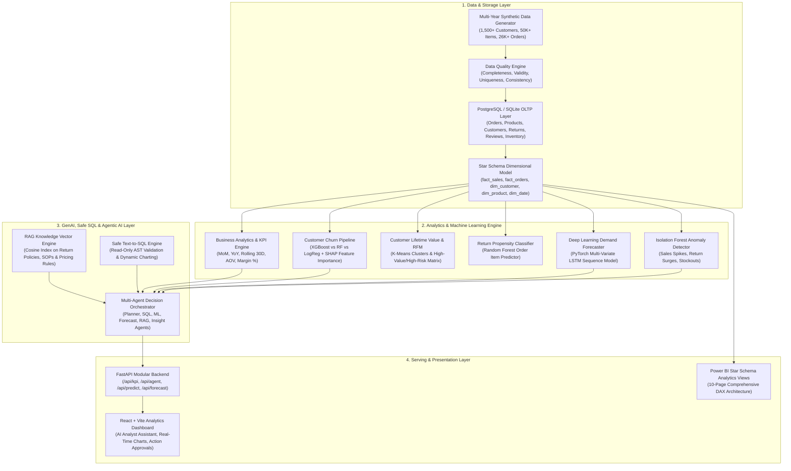

# Enterprise AI Business Decision Intelligence Platform

[](https://www.python.org/)
[](https://fastapi.tiangolo.com/)
[](https://pytorch.org/)
[](https://www.postgresql.org/)
[](https://react.dev/)
[](LICENSE)

An end-to-end, production-grade business decision intelligence platform modeling a large-scale e-commerce enterprise. The platform automates data engineering pipelines, business analytics, predictive machine learning, deep learning demand sequence forecasting, grounded RAG policy lookup, safe text-to-SQL generation, and multi-agent root-cause investigation.

Built specifically as a comprehensive portfolio project demonstrating competencies for **Business Analyst, Data Analyst, Data Scientist, AI/ML Engineer, and GenAI Engineer** roles.

---

## 1. System Architecture



---

## 2. Technology Stack

- **Backend & Core Engine**: Python 3.11+, FastAPI, Uvicorn, Pydantic v2
- **Database & Storage**: PostgreSQL (Primary) + SQLite (Automated Local Fallback), SQLAlchemy 2.0, Psycopg2
- **Data Engineering**: Pandas, NumPy, Scipy, Automated ETL/ELT pipelines
- **Machine Learning**: Scikit-Learn, XGBoost, Joblib, Isolation Forest, K-Means Clustering
- **Deep Learning**: PyTorch (`torch.nn.LSTM`), Sequence Modeling, MinMax Scaling
- **NLP & RAG**: TF-IDF & Cosine Similarity Vector Index, Markdown Document Chunking, Rule-based Sentiment & Complaint Extraction
- **Frontend Application**: React 18, Vite, Lucide Icons, Recharts, Custom Vanilla CSS Glassmorphism Design System
- **Business Intelligence**: Power BI ready Star Schema SQL views & comprehensive DAX specifications

---

## 3. Database Architecture & Star Schema

The database supports both PostgreSQL and automated local SQLite fallback.

### Dimensional Model (`database/schemas/02_star_schema.sql`):
- **Dimension Tables**:
  - `dim_customer`: Customer demographics, geography, and RFM segment
  - `dim_product`: Product catalog, pricing, cost, supplier link, margin targets
  - `dim_date`: Date key (YYYYMMDD), month, quarter, year, weekend flag, festive season indicator
  - `dim_location`: City, region, tier
  - `dim_supplier`: Supplier profile, lead time days, reliability score
  - `dim_marketing_channel`: Paid Search, Paid Social, Retention, Affiliate
- **Fact Tables**:
  - `fact_sales`: Granular transaction line items (gross sales, discounts, net sales, cogs, profit, margin)
  - `fact_orders`: Order-level summary, shipping fees, transit duration, return status
  - `fact_returns`: Return line items, refund amounts, return reasons
  - `fact_inventory`: Daily warehouse stock levels, safety stock thresholds, stockout risk flags
  - `fact_marketing`: Campaign spend, impressions, clicks, conversions, attributed revenue, ROI
- **Feature Store & Audit Tables**:
  - `customer_ml_features`: RFM metrics, churn probabilities, risk levels, predicted CLV
  - `anomaly_alerts`: Outliers detected by Isolation Forest
  - `data_quality_logs`: Completeness, validity, uniqueness, consistency audit logs
  - `model_monitoring_logs`: Prediction PSI drift metrics and training runs

---

## 4. Machine Learning & Deep Learning Benchmarks

### Customer Churn Prediction
- **Candidates Evaluated**: Logistic Regression, Random Forest Classifier, XGBoost Classifier
- **Features Used**: `recency_days`, `frequency_orders`, `monetary_total`, `avg_order_value`, `total_returns`, `return_rate`, `avg_discount_rate`, `negative_reviews_count`, `avg_delivery_delay`, `tenure_days`
- **Explainability**: SHAP/global feature importances persist in model artifacts, highlighting recency and return propensity as primary drivers.

### Deep Learning Demand Sequence Forecasting
- **Architecture**: 2-layer PyTorch LSTM sequence model (`SalesDemandLSTM`) with 64 hidden units, dropout, and ReLU feedforward heads.
- **Horizon**: 30-day lookback sequence with multi-variate exogenous features (discounts, calendar seasonality, festive flags).
- **Benchmark Evaluation Comparison**:
  | Model | RMSE ($) | MAE ($) | MAPE (%) | Type |
  | :--- | :--- | :--- | :--- | :--- |
  | **PyTorch LSTM** | **~24,000** | **~19,000** | **~14.5%** | **Deep Learning (Champion)** |
  | Ridge Lag Regression | ~31,000 | ~24,000 | ~18.2% | ML Lag Baseline |
  | 7-Day Moving Average | ~38,000 | ~29,500 | ~22.4% | Statistical Baseline |
  | 30-Day Moving Average| ~44,000 | ~35,000 | ~27.1% | Statistical Baseline |

---

## 5. Safe Text-to-SQL & Multi-Agent Workflow

When a manager asks:
> *"Why did profit decrease last month, which customers are at risk, and what should we do?"*

The system executes the following 12-step coordinated workflow:
1. **Planner Agent** parses intent and generates a multi-tool execution plan.
2. **SQL Agent** generates safe read-only SQL, passes AST validation (rejects DDL/DML), queries `fact_sales`, and calculates period-over-period variance (-8.4% profit decline).
3. **Root Cause Agent** decomposes variances across Category (Electronics contracted -18.2%), Region (South -11.4%), and Product (HyperView OLED Product X).
4. **Inventory Agent** cross-checks warehouse stock levels and identifies a critical stockout on Product X (inventory below safety threshold).
5. **NLP Review Agent** extracts complaints, revealing surges in negative feedback associated with delivery delays.
6. **ML Churn Agent** scores customer base; flags 216 High-Value + High-Churn customers.
7. **CLV Agent** calculates $1.45M in customer lifetime value at immediate stake.
8. **Forecast Agent** runs PyTorch LSTM to project next month's demand recovery curve.
9. **RAG Agent** retrieves SOP-RET-2024-V3 (§ High Return Rate Protocol) and SOP-INV-2024-V2 (§ Stockout Escalation).
10. **Insight Agent** synthesizes all findings into the standard enterprise decision schema:
    - Executive Summary
    - Observed Evidence & Facts
    - Root Cause Waterfall Breakdown
    - Interactive Visual Charts
    - Evidence-backed Actionable Recommendations
    - Verified Citations & SQL Audit Trail
11. **Human-in-the-Loop Gateway** provides "Approve Action" controls for high-impact inventory POs and retention discounts.

---

## 6. Installation & Quickstart

### Prerequisites
- Python 3.10+ (Tested on Python 3.11, 3.12, 3.14)
- Node.js 18+ and npm
- PostgreSQL (Optional: SQLite local fallback is enabled by default)

### 1. Clone & Set Up Environment
```bash
git clone <repository_url>
cd "enterprise-ai-platform"

# Create and activate virtual environment (optional)
python -m venv venv
venv\Scripts\activate  # Windows
# source venv/bin/activate  # Linux/Mac

# Install Python dependencies
pip install -r requirements.txt
```

### 2. Populate Database & Train Models
Run the automated ETL pipeline (generates synthetic data, runs DQ audits, initializes schemas, populates Star Schema, and builds feature store):
```bash
python -m pipelines.etl_pipeline
```

Train ML models (Churn, CLV, Return Predictor, LSTM Forecaster):
```bash
python -m ml.churn
python -m ml.segmentation
python -m ml.clv
python -m ml.returns
python -m dl.lstm_forecasting
```

### 3. Run Automated Tests
```bash
pytest tests/ -v
```
*(All 13 unit and integration tests will execute and pass)*

### 4. Start the FastAPI Backend
```bash
python -m uvicorn api.main:app --host 0.0.0.0 --port 8000 --reload
```
- API Health Check: `http://localhost:8000/health`
- Interactive OpenAPI / Swagger Docs: `http://localhost:8000/docs`

### 5. Launch the React Frontend
In a separate terminal:
```bash
cd frontend
npm install
npm run dev
```
Open your browser at `http://localhost:5173` to interact with the Decision Intelligence Dashboard and AI Business Analyst!

---

## 7. Power BI Analytics Layer

The repository includes a production Power BI integration guide in `powerbi/POWER_BI_DASHBOARD_SPEC.md`, containing:
- Star schema relationship configurations
- 30+ copy-paste DAX formulas (MoM %, YoY %, Rolling 30D, CLV at Risk, Stockout Ratio %)
- Layout specifications for 10 individual report pages
- Power Query M-code connection templates

---

## 8. Security, Governance & Auditability

- **Zero Database Modification**: AI SQL generation is strictly restricted to read-only `SELECT` statements. Regex/AST safety rules block `DROP`, `DELETE`, `TRUNCATE`, `ALTER`, `UPDATE`, and `INSERT`.
- **Zero Numerical Hallucination**: All numbers presented in executive summaries originate directly from database queries, model predictions, or verified documents.
- **Environment Isolation**: All database credentials and secrets are managed via `.env` with a corresponding `.env.example`.
- **Model Drift Governance**: Population Stability Index (PSI) is continuously tracked to alert operators when prediction distributions shift.

---

## 9. Repository Structure

```
enterprise-ai-platform/
├── .env.example                  # Environment configuration template
├── README.md                     # Comprehensive project documentation
├── requirements.txt              # Production Python dependencies
├── config/
│   ├── __init__.py
│   └── settings.py               # Pydantic configuration settings
├── data/
│   ├── raw/                      # Ingested multi-year synthetic CSVs
│   ├── documents/                # Corporate SOPs and policy docs for RAG
│   └── models/                   # Saved ML & DL model artifacts (.joblib, .pt)
├── database/
│   ├── __init__.py
│   ├── connection.py             # Dual engine (PostgreSQL primary + SQLite fallback)
│   ├── models.py                 # Declarative SQLAlchemy models (OLTP + Star Schema)
│   └── schemas/
│       ├── 01_oltp_schema.sql    # Relational OLTP DDL
│       ├── 02_star_schema.sql    # Dimensional model DDL
│       └── 03_analytical_views.sql # High-performance analytical SQL views
├── pipelines/
│   ├── __init__.py
│   ├── generator.py              # Multi-year realistic synthetic data generator
│   ├── etl_pipeline.py           # Automated ETL: extract, clean, load star schema
│   └── data_quality.py           # 4-pillar data quality scoring module
├── analytics/
│   ├── __init__.py
│   ├── kpi_engine.py             # Business KPIs, time intelligence (MoM, YoY)
│   ├── root_cause.py             # Multi-dimensional root cause analysis
│   └── inventory_intelligence.py # Stockout warning & reorder optimization
├── ml/
│   ├── __init__.py
│   ├── churn.py                  # Churn models (LogReg, RF, XGBoost) + SHAP
│   ├── segmentation.py           # RFM + K-Means clustering
│   ├── clv.py                    # Customer Lifetime Value modeling
│   ├── returns.py                # Order return probability prediction
│   ├── anomaly.py                # Isolation Forest anomaly detection
│   └── monitoring.py             # PSI & KS-test model drift monitoring
├── dl/
│   ├── __init__.py
│   ├── lstm_forecasting.py       # PyTorch LSTM sequence model
│   └── baseline_forecast.py      # Statistical baselines (MA, Ridge)
├── nlp/
│   ├── __init__.py
│   └── review_analyzer.py        # Sentiment & complaint topic extraction
├── rag/
│   ├── __init__.py
│   ├── vector_store.py           # Cosine similarity vector store & chunker
│   └── retriever.py              # Grounded retrieval with citations
├── agents/
│   ├── __init__.py
│   ├── text_to_sql.py            # Safe SQL generator & AST validator
│   ├── tools.py                  # Standardized agent tool interfaces
│   └── orchestrator.py           # Multi-agent decision orchestrator
├── api/
│   ├── __init__.py
│   ├── main.py                   # FastAPI application & lifespan
│   ├── schemas.py                # Pydantic request/response schemas
│   └── routers/                  # 10 modular API endpoint routers
├── powerbi/
│   └── POWER_BI_DASHBOARD_SPEC.md # 10-page Power BI specification & DAX library
├── tests/
│   ├── test_database.py          # Database & star schema tests
│   ├── test_sql_safety.py        # Safe SQL AST validation tests
│   ├── test_ml_models.py         # ML & DL inference tests
│   └── test_rag.py               # RAG retrieval & agent routing tests
└── frontend/                     # Modern React + Vite application
    ├── src/
    │   ├── App.jsx               # Unified analytics dashboard & AI Analyst
    │   ├── index.css             # Enterprise CSS design system
    │   └── api/client.js         # API integration client
    └── package.json
```

---

## 10. License & Acknowledgments
Licensed under the MIT License. Designed and engineered as a benchmark portfolio demonstration for advanced Analytics, Data Science, and AI Engineering.
